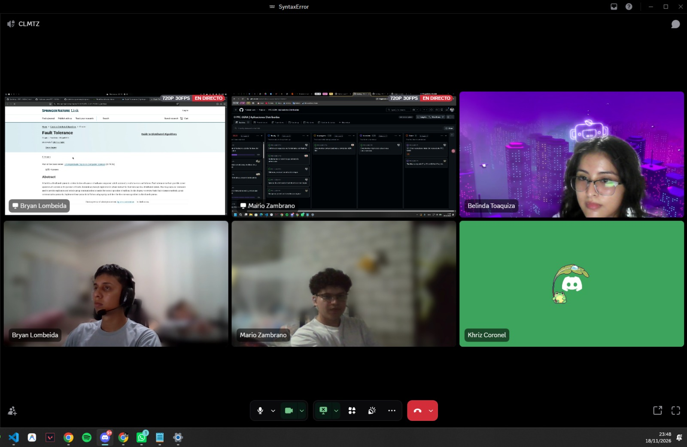

# Bitácora — SGRA, PFC

## 18 de noviembre de 2026 — Revisión del issue #5

**Integrante responsable de la revisión:** TOAQUIZA ZAMBRANO BELINDA BETZABETH.

### Revisión de la documentación disponible

- Revisé el issue #5 y el aporte de Bryan en el commit `9c47573`. Los ADR documentan módulos, dependencias y alternativas del SGRA previo.
- Contrasté ese registro con la propuesta de comunicación de Khriz del commit `0f35cd1`. ADR-001 permanece en evaluación y ADR-002 registra una propuesta pendiente de validación.
- Identifiqué pendientes para completar el cierre del issue: registrar los acuerdos sobre alcance, reutilización, tecnologías, datos críticos y convenciones de documentación; completar la fecha y los asistentes reales de la sesión; y enlazar el primer bosquejo y la fotografía con integrantes y fecha visibles.

### Resultado

El aporte técnico de Bryan está registrado. El cierre del issue #5 queda pendiente de incorporar los acuerdos y las evidencias de la sesión que solicita su descripción.

## 17 de noviembre de 2026

**Integrantes participantes**

Mario Zambrano.

### Actividades realizadas

- Revisé los requisitos de la primera entrega del Proyecto Fin de Curso (PFC-E1) de Aplicaciones Distribuidas.
- Organicé la estructura inicial del repositorio para trabajar con el proyecto SGRA.
- Preparé el documento LaTeX con las secciones correspondientes a los 17 apartados solicitados en la actividad.
- Separé las secciones del documento en archivos `.tex` independientes para facilitar el trabajo de los integrantes.
- Reorganicé el archivo principal `main.tex` dentro de la carpeta `docs/`.
- Integré la configuración y los paquetes de LaTeX directamente en `main.tex`.
- Preparé las carpetas `src/`, `docs/`, `docs/adr/`, `docs/diagramas/` y `evidencias/`.
- Dejé creadas las plantillas de los archivos `ADR-001` y `ADR-002` para registrar posteriormente las decisiones arquitectónicas.
- Preparé el archivo `.gitignore` para evitar incluir archivos temporales de compilación y configuraciones locales.

### Problemas y comportamientos observados

Ningun problema observado, como es la base no tuve problemas

### Solución y recuperación

Todo bien

### Resultados obtenidos

- Se estableció una estructura inicial organizada para el desarrollo del PFC-SGRA.
- El documento LaTeX quedó dividido en secciones que permiten trabajar de manera independiente.
- Se prepararon los directorios destinados al código fuente, documentación, diagramas y evidencias.
- Se dejaron las plantillas ADR listas para completar cuando se definan las decisiones arquitectónicas.
- Se verificó la compilación inicial del documento LaTeX.
- La base quedó preparada para incorporarse al repositorio GitHub y continuar con el desarrollo de la primera entrega.

### Tiempo dedicado

4 horas y 23 minutos.

## 17 de noviembre de 2026 — Planificación de E1 y E2

**Integrante participante:** TOAQUIZA ZAMBRANO BELINDA BETZABETH.

### Actividades realizadas

- Revisé las rúbricas y preparé la planificación y el reparto de trabajo de E1 para el tablero **PFC-SGRA | Aplicaciones Distribuidas** en GitHub Projects.
- Detallé E1 en tareas principales y subtareas con responsables, archivos a editar, dependencias, fechas objetivo y criterios de cierre.
- Distribuí las tareas de análisis, implementación, documentación y revisión entre los cuatro integrantes. Asumí la coordinación de la planificación, el resumen ejecutivo y los trabajos relacionados de E1.
- Identifiqué las entrevistas y la trazabilidad del SGRA previo como insumos para E1. Incorporé una tarea para recuperar y verificar la evidencia original antes de vincularla con los requisitos reformulados.

### Acuerdos de trabajo

- Los roles orientan las responsabilidades. Los cuatro integrantes aportan a la documentación y a la revisión de la entrega.
- El equipo decidirá en conjunto qué reutilizar del SGRA previo, qué tecnologías emplear y qué convenciones seguir para diagramas, documentación y trazabilidad.

### Tiempo dedicado

1 hora.

## 17 de noviembre de 2026 — Búsqueda de normas y guías para E1

**Integrante participante:** TOAQUIZA ZAMBRANO BELINDA BETZABETH.

### Actividades realizadas

- Busqué normas y guías para el levantamiento de información, la redacción y trazabilidad de requisitos, los diagramas de arquitectura y los registros de decisiones (ADR). Contrasté las ediciones con los catálogos oficiales y revisé los PDF disponibles.
- Seleccioné cinco fuentes para el equipo. SWEBOK v4.0a orienta el levantamiento. ISO/IEC/IEEE 29148:2011 sirve para redactar requisitos verificables y enlazarlos con la evidencia. ISO/IEC 25010:2011 aporta el modelo de calidad para los requisitos no funcionales. Las figuras 1 y 2 del artículo de Atodiresei, Băutu y Băutu (2024) muestran ejemplos C4 de contexto y contenedores. La guía de AWS orienta la redacción de los ADR.
- Actualicé la bibliografía con las normas, guías y el artículo seleccionado para E1. Organicé las copias de consulta en `docs/referencias/PDFs_Fuentes/` y vinculé las referencias con las secciones del informe donde se aplicarán.

### Resultados obtenidos

- La bibliografía en `docs/referencias/referencias.bib` reúne las cinco fuentes seleccionadas. Cada cita quedó junto a la indicación pendiente de la sección del informe donde el equipo la utilizará.
- Verifiqué que el documento recompilado muestra las cinco referencias.

### Tiempo dedicado

1 hora.

## 17 de noviembre de 2026 — Registro técnico del SGRA

**Integrantes participantes:** Khriz Alexander Coronel Gomez, Bryan Humberto Lombeida Escaleras, Belinda Betzabeth Toaquiza Zambrano, Luis Mario Zambrano Parraga

### Actividades realizadas

- Se converso la estructura del backend y del frontend para identificar módulos, dependencias y mecanismos de comunicación.
- Registré el contexto y las alternativas de estilo arquitectónico en `docs/adr/ADR-001-estilo-arquitectura.md`.
- Registré el contexto y las alternativas de comunicación en `docs/adr/ADR-002-mecanismo-comunicacion.md`.
- Actualicé las secciones del informe que recogen estos registros.

### Decisiones

- El estilo arquitectónico se evalúa entre monolito modular por capas con SPA separada, microservicios por dominio y arquitectura orientada a eventos.
- El mecanismo de comunicación se evalúa entre REST/HTTP JSON síncrono, gRPC y mensajería asíncrona.
- Los registros técnicos se conservan en `docs/adr/` y se resumen en las secciones 8, 9 y 11 del informe.

### Problemas y comportamientos observados

Ninguno.

### Solución y recuperación

Sin incidencias.

### Resultados obtenidos

- Los dos ADR contienen el contexto técnico y las opciones consideradas.
- El informe incorpora los registros en las secciones correspondientes.

### Tiempo dedicado

2 horas.

## 18 de noviembre de 2026 — Documentación del contexto y problemática del SGRA

**Integrante participante:** Mario Zambrano.

### Actividades realizadas

- Revisé la documentación del SGRA desarrollada en semestres anteriores para recuperar información sobre el proceso de refuerzo académico en la UTEQ.
- Consulté el levantamiento de información realizado con coordinación académica, identificando las principales dificultades relacionadas con la disponibilidad docente, la comunicación y la organización de tutorías.
- Desarrollé los cuatro subapartados de `docs/secciones/03-contexto.tex`: organización y usuarios, proceso actual y consecuencias, interesados y necesidades, y levantamiento y trazabilidad.
- Elaboré dos tablas para identificar las necesidades de los interesados y relacionar los hallazgos de la entrevista con sus respectivas marcas de tiempo.
- Incorporé la referencia bibliográfica de la entrevista en `docs/referencias/referencias.bib` y revisé las citas utilizadas en el texto.
- Ajusté la presentación de las tablas en LaTeX y recompilé el documento para verificar su visualización.

### Problemas y comportamientos observados

Durante la compilación del documento, las tablas aparecían identificadas como «Cuadro» en lugar de «Tabla». También observé que la referencia de la entrevista no se mostraba correctamente debido a una diferencia entre la clave utilizada en el texto y la registrada en el archivo bibliográfico.

### Solución y recuperación

Se ajustó la configuración de LaTeX para mostrar la denominación «Tabla» y se corrigió la clave bibliográfica correspondiente. Después de recompilar el documento, las tablas y las citas se visualizaron correctamente.

### Resultados obtenidos

- Se completó la redacción inicial del apartado de contexto y planteamiento del problema del SGRA.
- Se identificaron las necesidades de los actores involucrados y las dificultades documentadas durante el levantamiento anterior.
- Se incorporaron dos tablas de apoyo para organizar los interesados y la trazabilidad de los hallazgos.
- Se verificó la presentación del contenido en el documento PDF.
- Los cambios quedaron registrados en GitHub y asociados al issue #9.

### Evidencias

- **Issue:** [#9 — Documentar el proceso actual y sus consecuencias](https://github.com/Yukisan-uwo/PFC-SGRA/issues/9).
- **Commit:** [773b0be — Desarrollar contexto y trazabilidad del SGRA](https://github.com/Yukisan-uwo/PFC-SGRA/commit/773b0be).
- **Archivos modificados:** `docs/secciones/03-contexto.tex`, `docs/referencias/referencias.bib`, `docs/main.tex` y `docs/main.pdf`.

### Tiempo dedicado

1 hora y 14 minutos.
## 18 de noviembre de 2026 — Segunda sesión del día: alcance, reutilización, tecnologías y datos críticos

**Integrantes participantes:** Khriz Alexander Coronel Gomez, Bryan Humberto Lombeida Escaleras, Belinda Betzabeth Toaquiza Zambrano, Luis Mario Zambrano Parraga.

### Actividades realizadas

- Revisé con el equipo el alcance del SGRA para E1 y la base funcional reutilizable.
- Acordamos los límites del sistema, los módulos que se reutilizan y la base tecnológica.
- Identificamos los datos críticos candidatos para el análisis de consistencia y disponibilidad.
- Registré los acuerdos en `docs/adr/ADR-003-alcance-reutilizacion-tecnologias.md` y en la sección 11 del informe.

### Acuerdos

- Alcance: estudiantes, docentes, coordinación y administración; autenticación, catálogos académicos, solicitudes, programación, asistencia, recursos, historial y administración de usuarios y roles. Quedan fuera de E1 los pagos, la videoconferencia integrada, la aplicación móvil nativa, el chat propio y la analítica predictiva.
- Reutilización: se conserva la organización por capas y dominios del backend, las funciones de refuerzo y seguridad y la estructura de la SPA por roles; se adaptan nombres, configuración y documentación al PFC.
- Tecnologías: Java 21, Spring Boot 4.0.3, Maven, Spring Data JPA, PostgreSQL, Spring Session, Angular 21, TypeScript 5.9, Bootstrap 5.3, Chart.js 4.5 y REST/HTTP JSON.
- Datos críticos: identidad y permisos, solicitudes, programación de sesiones, participantes, asistencia, recursos e historial.

### Evidencia de la sesión

La captura muestra a los cuatro integrantes en la sesión y el tablero del proyecto; el reloj de la reunión indica 18/11/2026 23:48.

### Problemas y comportamientos observados

Ninguno.

### Solución y recuperación

Sin incidencias.

### Resultados obtenidos

- Los acuerdos de alcance, reutilización, tecnologías y datos críticos quedaron registrados en el ADR-003.
- El informe resume los acuerdos en la sección de registros de arquitectura.
- La sesión queda documentada con la captura de la reunión.

### Tiempo dedicado

1 hora.

## 19 de noviembre de 2026 — Recuperación y verificación de evidencias del levantamiento del SGRA

**Integrante participante:** TOAQUIZA ZAMBRANO BELINDA BETZABETH.

### Actividades realizadas

- Revisé las transcripciones del levantamiento anterior del SGRA y las referencias con enlaces a entrevistas, encuestas y conversaciones de validación.
- Recuperé de Google Drive cinco audios de entrevistas y tres consentimientos firmados. Revisé visualmente los consentimientos y comprobé su autorización para grabar voz y utilizar los audios con fines educativos.
- Organicé el material en `evidencias/levantamiento/`, con carpetas de audios, consentimientos y fotografías. Preparé un inventario que relaciona cada entrevista con su participante, su archivo, su enlace y el respaldo de consentimiento disponible.
- Incorporé una copia de la documentación anterior y recuperé sus cinco transcripciones, conservando las intervenciones y las marcas de tiempo disponibles.
- Recuperé una fotografía del trabajo presencial con los interesados y la incorporé como evidencia referencial.
- Añadí al informe el Anexo A de evidencias del levantamiento y trazabilidad y el Anexo B con las transcripciones de las cinco entrevistas.
- Actualicé la bibliografía y las citas del contexto para enlazar la entrevista de coordinación. Registré también las fuentes de los consentimientos y el panel de resultados de la encuesta.
- Recompilé el documento después de integrar los cambios del equipo y comprobé las referencias y la presentación de los anexos.

### Problemas y comportamientos observados

La sección de contexto citaba la carpeta de validaciones posteriores en lugar del audio de la entrevista de coordinación. Las transcripciones de Angelita Bosquez y Daisy Nata carecen de marcas de tiempo. Los tres consentimientos recuperados muestran firmas, pero carecen de fecha de firma visible. Durante la compilación, la fuente monoespaciada configurada impedía generar el PDF y algunos enlaces largos se extendían fuera de los márgenes.

### Solución y recuperación

Corregí la referencia de la entrevista de coordinación, asocié las fuentes con identificadores de entrevista y conservé las preguntas y respuestas de las transcripciones sin agregar tiempos. Documenté las limitaciones de los consentimientos y las comprobaciones pendientes. Ajusté la fuente monoespaciada y los saltos de línea de los enlaces bibliográficos para completar la compilación.

### Resultados obtenidos

- Las cinco entrevistas, los tres consentimientos firmados y la fotografía referencial quedaron organizados y enlazados en el inventario.
- El informe incluye las evidencias y las cinco transcripciones en anexos consultables desde el índice.
- Se corrigió la trazabilidad bibliográfica del contexto hacia el audio de coordinación.
- El PDF recompilado tiene 24 páginas e incorpora los cambios del equipo.
- El inventario identifica como pendientes el cotejo de los fragmentos con los audios, la recuperación de las respuestas crudas de la encuesta y las comprobaciones de acceso y fechas que correspondan al issue #8.
- Los cambios del levantamiento quedaron registrados en GitHub y asociados al issue #8.

### Evidencias

- **Issue:** [#8 — Recuperar y verificar la evidencia original](https://github.com/Yukisan-uwo/PFC-SGRA/issues/8).
- **Commit:** [482f02e — Incorpora evidencias del levantamiento y transcripciones](https://github.com/Yukisan-uwo/PFC-SGRA/commit/482f02e).
- **Inventario:** [Evidencias del levantamiento](evidencias/levantamiento/README.md).
- **Archivos modificados:** `README.md`, `docs/main.tex`, `docs/main.pdf`, `docs/referencias/referencias.bib`, `docs/secciones/03-contexto.tex`, `docs/secciones/17-referencias.tex`, `docs/secciones/18-evidencias.tex`, `docs/secciones/19-transcripciones.tex` y los archivos de `evidencias/levantamiento/`.

### Tiempo dedicado

2 horas.

## 19 de noviembre de 2026 — Definición de requisitos no funcionales del SGRA

**Integrante participante:** Mario Zambrano.

### Actividades realizadas

- Revisé el issue #12 y los requisitos de calidad del SGRA para adaptarlos a la primera entrega del PFC de Aplicaciones Distribuidas.
- Desarrollé seis requisitos no funcionales en `docs/secciones/06-requisitos.tex`, relacionados con rendimiento, disponibilidad, usabilidad, compatibilidad entre navegadores, auditoría e integridad de la información.
- Establecí las características correspondientes de ISO/IEC 25010, las metas cuantificadas, las condiciones de evaluación y los métodos de prueba.
- Redacté las justificaciones de los seis requisitos, considerando su importancia para el funcionamiento y la gestión de refuerzos académicos.
- Incorporé una tabla de trazabilidad que relaciona los requisitos RNF01–RNF06 con sus identificadores de calidad RQA.
- Compilé el documento LaTeX con pdfLaTeX y Biber para revisar la presentación de las tablas, las justificaciones y la trazabilidad en el PDF.
- Realicé ajustes puntuales en la estructura de la tabla y en la redacción de la trazabilidad.

### Problemas y comportamientos observados

Durante la revisión del PDF observé que la tabla de requisitos no funcionales se distribuía en varias páginas y presentaba una separación excesiva de palabras debido al ancho de las columnas. También identifiqué que el título de la subsección quedaba separado del inicio de la tabla.

Además, quedó pendiente precisar algunos criterios de medición, especialmente las condiciones de ejecución y la duración de las pruebas de rendimiento.

### Solución y recuperación

Realicé ajustes en la distribución de las columnas y en el salto de página de la subsección. También corregí la descripción introductoria de la tabla de trazabilidad para relacionarla directamente con los requisitos no funcionales.

### Resultados obtenidos

- Se definieron los seis requisitos no funcionales solicitados en el issue #12.
- Cada requisito cuenta con una característica de calidad, una meta verificable y un método de prueba.
- Se incorporaron las justificaciones de los umbrales establecidos.
- Se añadió la tabla de trazabilidad entre los identificadores RQA y RNF.
- Se comprobó que el contenido desarrollado aparece en el documento PDF.
- Los cambios quedaron registrados en GitHub. El issue #12 permanece abierto hasta completar la revisión final de los criterios de medición.

### Evidencias

- **Issue:** [#12 — Definir seis requisitos no funcionales verificables](https://github.com/Yukisan-uwo/PFC-SGRA/issues/12).
- **Commit:** [7b67c86 — Definir seis requisitos no funcionales verificables](https://github.com/Yukisan-uwo/PFC-SGRA/commit/7b67c86785).
- **Archivo modificado:** `docs/secciones/06-requisitos.tex`.
- **Verificación:** compilación local del documento LaTeX y revisión visual de las tablas y justificaciones en el PDF.

### Tiempo dedicado

2 horas y 54 minutos.
